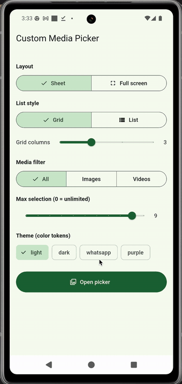
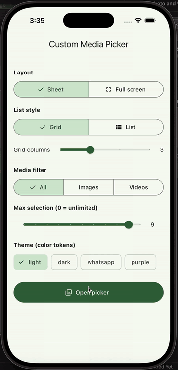

# Custom Media Picker

A Flutter package that lets you pick images and videos from the device gallery using a custom UI instead of relying on a 3rd-party picker package. It uses native Android and iOS access through platform channels and supports previews, selection limits, and theming.

## Features

- Image and video selection
- Grid or list layouts
- Bottom sheet or full-screen picker
- Filtering by media type
- Selection limits and callback hooks
- Customizable color tokens
- Custom sort on the Recent tab (old → new, new → old, or a custom date range)
- Full-image and video preview support

## Demo

| Android | iOS |
| :---: | :---: |
|  |  |

## Platform support

| Platform | Supported | Backing API |
| --- | --- | --- |
| Android | ✅ API 24+ | `MediaStore` |
| iOS | ✅ 15+ | `PhotoKit` (`PHAsset`) |
| Web / desktop | ❌ | no native implementation — `CustomMediaPicker.pick` returns `null` |

## Installation

```bash
flutter pub add custom_media_picker
```

or add it directly to your `pubspec.yaml`:

```yaml
dependencies:
  custom_media_picker: ^0.2.0
```

Requires Flutter 3.50+ (Dart 3.14+).

## Native setup

Since 0.2.0 this is a Flutter **plugin**: the Android and iOS code registers
itself, so there is nothing to copy into `MainActivity` or `AppDelegate`.
Upgrading from 0.1.x? Your pasted `MediaPickerHandler` keeps working, but it
takes over the channel and hides the plugin's fixes — delete it and its
channel registration from `MainActivity`/`AppDelegate`.

### Android

The plugin's manifest already declares the gallery permissions below; they
are merged into your app automatically. `minSdk` must be 24 or higher.

### iOS

Add the usage description to `ios/Runner/Info.plist`. iOS will not show the
permission dialog without it, and the app will not appear under
*Settings → Privacy → Photos*:

```xml
<key>NSPhotoLibraryUsageDescription</key>
<string>Photos access is needed to pick images and videos from your gallery.</string>
```

Set the iOS deployment target to 15.0 or higher (`platform :ios, '15.0'` in
the `Podfile`).

## Permissions reference

| Platform | Declaration | Applies to |
| --- | --- | --- |
| Android 13+ (API 33) | `READ_MEDIA_IMAGES`, `READ_MEDIA_VIDEO` | full gallery read |
| Android 14+ (API 34) | `READ_MEDIA_VISUAL_USER_SELECTED` | partial ("Select photos") access |
| Android ≤ 12 (API 32) | `READ_EXTERNAL_STORAGE` with `maxSdkVersion="32"` | legacy gallery read |
| iOS | `NSPhotoLibraryUsageDescription` | full + limited photo library access |

`CustomMediaPicker.pick` requests access on your behalf and calls
`config.onPermissionDenied` when the user refuses. Nothing is written to the
gallery, so `NSPhotoLibraryAddUsageDescription` and `WRITE_EXTERNAL_STORAGE`
are **not** needed.

## Usage

```dart
import 'package:custom_media_picker/custom_media_picker.dart';

final assets = await CustomMediaPicker.pick(
  context,
  config: MediaPickerConfig(
    layoutStyle: LayoutStyle.sheet,
    listStyle: ListStyle.grid,
    gridCrossAxisCount: 3,
    maxSelection: 9,
    mediaFilter: MediaFilter.all,
    title: 'Select media',
    onPermissionDenied: () => debugPrint('Photos permission denied'),
  ),
);

if (assets != null) {
  for (final asset in assets) {
    // Already resolved when config.resolvePathsOnConfirm is true (the default);
    // otherwise call `await asset.resolvePath()`.
    debugPrint(asset.resolvedPath);
  }
}
```

`pick` returns `null` when the user dismisses the picker **or** when permission
was denied.

### Handling permission yourself

`MediaPickerChannel` exposes the permission calls if you want to show your own
rationale before the system dialog, or offer a way back after a refusal:

```dart
final status = await MediaPickerChannel.checkPermissionStatus();

switch (status) {
  case MediaPermissionStatus.granted || MediaPermissionStatus.limited:
    break; // ready
  case MediaPermissionStatus.notDetermined || MediaPermissionStatus.denied:
    // The system dialog can still be shown (Android re-asks once after a
    // first refusal).
    await MediaPickerChannel.requestPermissionStatus();
  case MediaPermissionStatus.permanentlyDenied:
    // iOS after any refusal, Android after "Don't ask again". Ask anyway
    // first: if the user reset the permission in Settings, Android shows the
    // dialog again; otherwise the request returns at once.
    final again = await MediaPickerChannel.requestPermissionStatus();
    if (!again.hasAccess) await MediaPickerChannel.openAppSettings();
}
```

`limited` (iOS 14+ "Selected Photos", Android 14+ partial access) is a working
state: the picker shows the subset the user granted.

## Selection limit

With `maxSelection` set, a tap past the limit shows a short notice inside the
picker (and in the preview). Don't use a `SnackBar` from
`onSelectionLimitReached` for this: it's drawn under the picker's modal sheet,
so the user never sees it.

```dart
MediaPickerConfig(
  maxSelection: 9,
  // Text only:
  selectionLimitMessage: (max) => 'Up to $max photos',
  // Or your own widget (replaces the default notice):
  selectionLimitNoticeBuilder: (context, max) => MyBanner('Max $max items'),
  // Or nothing at all:
  // showSelectionLimitMessage: false,
  onSelectionLimitReached: () => HapticFeedback.lightImpact(),
)
```

### Sharing the limit with the camera

Items the user already has outside the picker (e.g. camera captures) count
toward `maxSelection` through `externalSelectedCount`; the camera does the
same with `selectedCount`:

```dart
// Gallery: 2 max, 1 photo already taken → only 1 more can be picked.
CustomMediaPicker.pick(context, config: MediaPickerConfig(
  maxSelection: 2,
  externalSelectedCount: captures.length,
));

// Camera: refuses the capture once picks + captures reach the max.
CustomMediaPicker.capture(context, config: CameraConfig(
  maxSelection: 2,
  selectedCount: picked.length + captures.length,
));
```

## Camera (photo & video)

`CustomMediaPicker.capture` opens a full-screen camera and returns the photo or
video the user accepted (`CapturedMedia`), or `null` if they closed it.

```dart
final media = await CustomMediaPicker.capture(
  context,
  config: CameraConfig(
    modes: [CaptureMode.photo, CaptureMode.video], // tap = photo, hold = video
    maxVideoDuration: const Duration(seconds: 30),
    saveToGallery: true,               // also add it to the device gallery
    galleryAlbum: 'My App',
    // Share a limit with the gallery picker: 2 already picked of max 2 →
    // the next capture is refused with a notice when the user taps Use.
    maxSelection: 2,
    selectedCount: alreadyPicked.length,
  ),
);
if (media != null) {
  print('${media.type} ${media.path} ${media.duration} ${media.galleryId}');
}
```

Built in: photo and video modes, hold-to-record, self-timer, flash
(off/auto/on/torch), front/back switch, pinch-to-zoom, tap-to-focus, a
retake/use review screen, and silent video when the microphone is denied.

### Fully custom UI

Colors (`CameraColors`) and every label are configurable. Each part of the
screen can also be replaced with your own widget; the builder gets a
`CameraControls` with the state (`mode`, `isRecording`, `recordingElapsed`,
`flash`, `zoom`, `countdown`, `isAtSelectionLimit`, ...) and the actions
(`capture()`, `startRecording()`, `stopRecording()`, `switchLens()`,
`cycleFlash()`, `setZoom()`, `close()`, ...):

```dart
CameraConfig(
  topBarBuilder: (context, c) => MyTopBar(onClose: c.close, flash: c.flash),
  shutterBuilder: (context, c) => MyShutter(
    recording: c.isRecording,
    onTap: c.capture,
  ),
  overlayBuilder: (context, c) => const GridLines(),
  reviewBuilder: (context, media, retake, use) => MyReview(media, retake, use),
  permissionDeniedBuilder: (context, openSettings, close) => MyDenied(...),
  selectionLimitNoticeBuilder: (context, max) => MyToast('Max $max'),
)
```

The default parts are public too (`DefaultShutterButton`,
`DefaultCameraTopBar`, `DefaultCameraBottomBar`, `DefaultCameraReview`, ...),
so a custom layout can reuse them.

### Camera setup

- **iOS** `Info.plist`: `NSCameraUsageDescription`,
  `NSMicrophoneUsageDescription` (video sound) and, with `saveToGallery`,
  `NSPhotoLibraryAddUsageDescription`.
- **Android**: camera and microphone permissions come from the `camera`
  plugin's manifest. Saving to the gallery needs no permission on Android 10+;
  on Android 9 and lower `WRITE_EXTERNAL_STORAGE` must already be granted,
  otherwise `onSaveToGalleryFailed` is called and the capture is still returned.

## Sorting

The Recent tab can show a sort row under the tab bar with three modes:

- **New to old** — default once sorting is on.
- **Old to new**.
- **Custom range** — opens the picker's own date range sheet (not the stock
  Flutter dialog); the feed is then restricted to that window (newest first
  within it). Swipe or use the chevrons to page between months.

`enableSort` defaults to `false` — the picker ships with no sort row until
you turn it on:

```dart
MediaPickerConfig(
  enableSort: true, // off by default; set true to show the sort row
  initialSortOrder: MediaSortOrder.newestFirst,
  dateRangeStartLabel: 'Start Date', // header placeholder before a start day is picked
  dateRangeEndLabel: 'End Date',
  dateRangeSaveLabel: 'Save',
  colors: MediaPickerColors(
    sortAccent: Color(0xFF25D366),          // selected option / active row tint
    dateRangeSurface: Color(0xFFFFFFFF),    // sheet background
    dateRangeHeaderText: Color(0xFFFFFFFF), // text on top of dateRangeSelectedFill
    dateRangeRangeText: Color(0xFF1C1C1E),
    // dateRangeSelectedFill / dateRangeRangeFill are left unset here, so
    // they default to confirmButton (and confirmButton at 50% opacity for
    // the in-range days) — pass your own Color to override either one.
  ),
)
```

Sorting only affects the Recent feed — album feeds are always newest-first.
The custom range compares the capture date (`dateTaken`) on both platforms.

## Example app

The repository includes a demo app in `example/` showing many configuration
options, theme presets, selection workflows, and a complete permission request
flow with a Settings fallback.

```bash
cd example
flutter pub get
flutter run
```

## Troubleshooting

| Symptom | Cause |
| --- | --- |
| Picker closes instantly, no permission dialog | Running on web/desktop, or an old 0.1.x `MediaPickerHandler` is still registered on the same channel. Remove it. |
| iOS: app missing from *Settings → Privacy → Photos* | `NSPhotoLibraryUsageDescription` missing from `Info.plist`. |
| Status is `permanentlyDenied` | The user refused for good — send them to Settings via `openAppSettings()`. |
| Gallery is empty after granting | Status is `limited`; the user picked a subset. Call `openAppSettings()` to let them widen it. |

## Notes

- Android 14+ partial access is supported through the native media picker flow.
- iOS can resolve assets from iCloud when needed — the first `resolvePath()` on
  an iCloud asset may take a moment while it downloads.
- The package is designed to work as a reusable library while keeping the example
  app and native integrations in the same repository.

## 👨‍💻 Maintainer

**Adel Mostafa**

Senior Flutter Developer

- 🌐 Portfolio: https://adel-portfolio-three.vercel.app
- 🐙 GitHub: https://github.com/Adelmostafa31
- 💼 LinkedIn: https://linkedin.com/in/adel-mostafa

## License

This project is licensed under the MIT License. See the [LICENSE](LICENSE) file for details.
